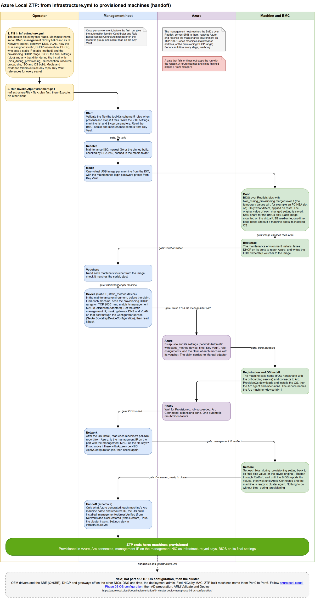

# azurelocal-ztp

> Zero-touch provisioning for Azure Local. Automates Microsoft's [simplified machine provisioning (preview)](https://learn.microsoft.com/azure/azure-local/deploy/simplified-machine-provisioning) end to end, from bare machines to provisioned, Arc-connected nodes, with no USB stick and no one in the rack.

## What it does

You supply an environment file. One command then:

1. Downloads and checks the maintenance ISO, and builds one virtual USB image per node.
2. Sets the BIOS values the file names, and boots each node from its image over the BMC (Redfish virtual media, USB-stick slot), all nodes in parallel.
3. Reads each node's ownership voucher back from its image.
4. Sets each static management address on the port with the node's management MAC, in the maintenance environment, before the claim.
5. Claims the machines in Azure with a Bicep template, waits for "Ready to cluster", and resubmits a failed OS install once.
6. Checks each management address on the management port through Azure, and moves it there if the install put it elsewhere.
7. Sets back any BIOS value that was changed for the install only, and waits until each machine is Connected again.
8. Writes a handoff with each machine's Arc machine name and `arcMachineResourceId`.

The stages are Resolve, Media, Boot, Bootstrap, Vouchers, Device, Azure, Ready, Network, Restore and Handoff. Each stage starts only when the gate before it passes, and a rerun resumes where the last run stopped.

**The result:** each machine is **Provisioned** in Azure and **Arc-connected**, and the handoff says, per node and per port, whether the management port (found by MAC) has the address the infrastructure file gives. With **Mode A** (DHCP plus a reservation, recommended) it does. With a static address (Modes B and C) it doesn't yet: Microsoft's OS install resets every port, and OS configuration sets the static afterwards. The nodes are ready for OS configuration, not yet for Validate. See [Management address modes](docs/prerequisites.md#management-address-modes). See [What's next: OS configuration](#whats-next-os-configuration).



## Where ZTP fits: the whole flow

ZTP is one step of the Azure Local route. Each step starts only when the one before it is done and checked.

```text
Hardware discovery -> ZTP -> OS configuration -> PRE-CLUSTER VERIFICATION GATE -> ARM Validate -> ARM Deploy -> day 2
```

| # | Step | Tool | What it does | Page |
| --- | --- | --- | --- | --- |
| 1 | Hardware discovery (optional, Dell only in this phase) | azurelocal-toolkit `Invoke-HardwareDiscovery.ps1` | Reads each machine's BMC over Redfish and fills the serial numbers and port MACs of the infrastructure file | [Discovery](https://github.com/AzureLocal/azurelocal-toolkit/blob/main/scripts/common/idrac-management/README.md) |
| 2 | **ZTP** (this repo) | `Invoke-ZtpEnvironment.ps1` | Installs the OS from Azure by simplified machine provisioning and registers every machine with Azure Arc. Ends at the handoff | This page |
| 3 | OS configuration | azurelocal-toolkit `Invoke-AzureLocalOsConfiguration.ps1` | Static management address by MAC, DHCP off on the other ports, DNS, time, deployment admin, domain join, storage preparation. The SBE only when a person asks (below) | [OS configuration](https://github.com/AzureLocal/azurelocal-toolkit/blob/main/docs/os-configuration-and-arm-deployment.md) |
| 4 | **Pre-cluster verification gate** | azurelocal-toolkit and the Sonar Verification monitor | A read-only check that every machine is ready for a cluster. Validate should not start until it passes. **Being built; not in main yet** | See the note below |
| 5 | ARM Validate | azurelocal-toolkit `Invoke-AzureLocalArmDeployment.ps1 -Mode Validate` | Submits the deployment in validate mode and reports each validation step | [ARM deployment guide](https://github.com/AzureLocal/azurelocal-toolkit/blob/main/docs/arm-deployment-guide.md) |
| 6 | ARM Deploy | the same script, `-Mode Deploy` | Creates the cluster. A separate, explicit run that needs a successful Validate | Same |
| 7 | Day 2 | the toolkit's post-deployment, operations and update tasks | Logical networks, monitoring, backup, updates | [Part 4: Cluster Deployment](https://azurelocal.cloud/docs/implementation/04-cluster-deployment/) |

[Sonar](https://github.com/AzureLocal/azurelocal-sonar) watches steps 2 to 6 read only; start it beside any of them.

<!-- TODO(gate): the pre-cluster verification gate and Sonar's Verification monitor are being built in the toolkit and Sonar repositories. When they are in main, link the toolkit page of the gate here and name the checks it makes. -->

**Pre-cluster verification gate.** It sits between OS configuration and ARM Validate. It is not part of ZTP and ZTP does not call it. It is being built in azurelocal-toolkit (and the Sonar Verification monitor in azurelocal-sonar) and is not in their main branches yet. Until it is published, check these yourself before Validate: the handoff's `managementAddressVerified` and the OS configuration report's `converged` for every node.

**The SBE is optional and never the default.** ZTP never touches the Solution Builder Extension: the OS install discovers its own. Nothing downstream stages one unless a person asks: the toolkit side-loads an SBE only when `hardware.sbe.delivery` is `winrm_copy` or `node_pull`. With no `hardware.sbe` block, or `delivery: skip`, the OS configuration Sbe and Drivers steps are skipped, the ARM deployment passes no SBE value, and the machines keep the OEM drivers the OS already has. See [the toolkit's SBE section](https://github.com/AzureLocal/azurelocal-toolkit/blob/main/docs/os-configuration-and-arm-deployment.md).
## Status

| Item | State |
| --- | --- |
| Microsoft feature | Preview. Provisioning resources in **East US** only. Arc gateway not supported. |
| End-to-end flow | **Proven on Dell AX-760 / iDRAC 7.30**: two nodes, Azure Local build `12.2690.1003.15`, maintenance image `10.2610.0.3063`. |
| Microsoft support | AX-760 isn't on Learn's [validated hardware list](https://learn.microsoft.com/azure/azure-local/deploy/simplified-machine-provisioning#hardware-prerequisites) for this flow (Dell AX-650 and AX-750, Lenovo ThinkAgile MX650 V3 and V4, HPE ProLiant DL360 Gen11). It works, but Microsoft doesn't support it. |
| Other OEMs | BMC handling is proven on Dell iDRAC only. |
| Scope | Ends at the handoff: provisioned, Arc-connected nodes with the management address on the management NIC. OS configuration, Active Directory preparation, Validate and Deploy are separate. |

## Prerequisites at a glance

The full list, with who checks what, is on the [Prerequisites](docs/prerequisites.md) page. It follows [Microsoft Learn, simplified machine provisioning (preview), train 2610](https://learn.microsoft.com/azure/azure-local/deploy/simplified-machine-provisioning).

| Need | Detail |
| --- | --- |
| PowerShell | PowerShell 7.0 or later, in an elevated session on Windows. Every script has `#Requires -Version 7.0`. Windows PowerShell 5.1 cannot run it. |
| Modules and tools | `powershell-yaml`; `Az.Accounts`, `Az.Resources`, `Az.KeyVault`, `Az.ConnectedMachine` (the code states no minimum versions); the Azure CLI with Bicep (`az bicep install`). Pester 5.9.1 only to run the tests. |
| Operating system | A Windows management host (the SMB share, the local account and the firewall rule are Windows features). It must reach the BMCs, the provisioning network and the internet, and stay up for the run (1.5 to 2 hours for two nodes). |
| Azure feature and resource providers | The feature `Microsoft.DeviceOnboarding/AzureLocalZTP` is registered, and these resource providers are registered in the subscription: `Microsoft.HybridCompute`, `Microsoft.AzureStackHCI`, `Microsoft.DeviceOnboarding`, `Microsoft.Edge`, `Microsoft.GuestConfiguration`, `Microsoft.HybridConnectivity`, `Microsoft.KeyVault`, `Microsoft.ManagedIdentity`, `Microsoft.PolicyInsights`, `Microsoft.Storage`, `Microsoft.Insights`. |
| Region | In the preview only **East US** supports the provisioning resources (the site and the edge machines). The resource group can be in another region. |
| Permissions | Owner, or Contributor and Role Based Access Control Administrator, on the resource group; Reader on the subscription; Key Vault Secrets User on each vault a `keyvault://` reference names. |
| Ownership vouchers | One small `.pem` file per machine, named after its serial number. The maintenance environment writes it to `\vouchers\<serial>\`. ZTP reads it back from the node's virtual USB image over the BMC (no USB stick, no one at the machine), checks that it holds the node's serial number, and claims the machine with it. Treat a voucher as a credential: keep the vouchers folder out of git. |
| Hardware | A BMC with Redfish over HTTPS (TCP 443) and virtual media on the USB-stick slot. Secure Boot and TPM on. Learn's validated list: Dell AX-650 and AX-750, Lenovo ThinkAgile MX650 V3 and V4, HPE ProLiant DL360 Gen11. The flow is proven on Dell AX-760 with iDRAC 7.30 (not on Learn's list). |
| Credentials | Only Key Vault references in the file: the BMC login, the provisioning admin password (at least 12 characters with lower and upper case, a digit and a special character) and, optionally, the `edgeuser` password of the maintenance environment. The Key Vault uses the Azure RBAC permission model. |
| Network and ports | Host to each BMC TCP 443; each BMC to the host TCP 445 (SMB); host to the provisioning network TCP 20001; host to the internet TCP 443; the machines to Azure TCP 443 and 80 with no HTTPS inspection. Arc gateway is not supported in the preview. |
## Quickstart

Check the [Prerequisites](docs/prerequisites.md) first. Then, on a Windows management host that reaches the BMCs, in an elevated PowerShell 7 session:

```powershell
git clone https://github.com/AzureLocal/azurelocal-ztp.git
cd azurelocal-ztp

# 1. Copy a toolkit template outside the repo and fill it in (no secrets: Key Vault references only).
#    ZTP only: infrastructure.ztp.example.yml. ZTP, then OS configuration and deployment: infrastructure.example.yml.
Copy-Item <azurelocal-toolkit>\config\variables\examples\infrastructure.ztp.example.yml D:\ztp\infrastructure.yml

# 2. Plan: changes nothing in Azure, on the BMCs or on the nodes
Connect-AzAccount -Tenant <tenant-id>
./scripts/simplified-provisioning/Invoke-ZtpEnvironment.ps1 -InfrastructureFile D:\ztp\infrastructure.yml

# 3. Execute: REINSTALLS the nodes; rerun the same command to resume
./scripts/simplified-provisioning/Invoke-ZtpEnvironment.ps1 -InfrastructureFile D:\ztp\infrastructure.yml -Execute
```

Which template to start from:

| You use | Start from |
| --- | --- |
| ZTP only, with nothing automated after it | The toolkit's ZTP-only template, [`infrastructure.ztp.example.yml`](https://github.com/AzureLocal/azurelocal-toolkit/blob/main/config/variables/examples/infrastructure.ztp.example.yml) |
| ZTP, then OS configuration and cluster deployment | The full template, [`infrastructure.example.yml`](https://github.com/AzureLocal/azurelocal-toolkit/blob/main/config/variables/examples/infrastructure.example.yml) |

Read the [Operator guide](docs/operator-guide.md) before you run it.

### Things to know before you run it

- **Static management address by MAC, before the claim.** `networking.management.static_method` is `device` (the default) or `site`. With `device`, the Device stage sets the address on the management port in the maintenance environment, the site's network setting is **Automatic**, and the claim carries no `Manual` adapter. `site` keeps the earlier path (site `Manual` over `site_ip_range`) for environments without the Device stage. The OS install resets every port to DHCP afterwards, so the Network stage only verifies, and OS configuration sets the static again by MAC.
- **No maintenance address needed.** Without `maintenance_address`, the Device stage scans `networking.management.provisioning_dhcp_range` (default: the management subnet, at most 4096 addresses) on TCP 20001 and finds each node by its management MAC.
- **Restore stage.** `hardware.bios_during_provisioning` holds BIOS values for the install only. Boot applies them; Restore sets them back to `hardware.bios` (or the value saved before Boot), restarts the node, and waits until it's Connected again. Without the key, Restore does nothing.
- **Network stage: verify-only.** It reads Azure's per-NIC report, finds the management port by MAC, and records `managementAddressVerified` with a reason that names the mode, the port, its MAC, what it has and what the file expects. It never sends or waits on a Microsoft job: `jobs/ApplyConfiguration` never started on two live runs. `-ApplyThroughAzure` keeps that path as an opt-in, documented as unreliable.
- **Handoff schema 2.** The handoff carries what Azure generated: the site, the installed `solution.vsrVersion`, and per node the edge and Arc machine names and IDs, `managementAddressVerified`, `managementMode`, `biosRestored` and `networkAdapters[]` (every port as Azure reports it after the install, matched by MAC to the file). It no longer carries `sbe`, `bootstrap`, `timestamps`, `connectivity` or a top-level `arcMachineResourceGroup`.
- **No SBE in ZTP.** The OS install discovers its own SBE. An SBE is optional and never the default: OS configuration side-loads one only when a person asks for it (`hardware.sbe.delivery`). A file with `hardware.sbe` or `ztp.node_preparation` still works; the run ignores them with a `Note:` line.

## What's next: OS configuration

ZTP doesn't set a static management address after the install, install OEM drivers, stage an SBE (optional, only on request), turn DHCP and the gateway off on the other NICs, set DNS or time on the host, or create the deployment admin. Those happen in OS configuration, [azurelocal-toolkit Phase 03: OS Configuration](https://azurelocal.cloud/docs/implementation/04-cluster-deployment/phase-03-os-configuration/), before Validate and Deploy. The toolkit's `Set-AzureLocalNodeConfiguration.ps1` does them over Arc Run Command, finding every port by MAC.

**The management address after ZTP, by mode** ([Management address modes](docs/prerequisites.md#management-address-modes)):

| Mode | `ip_assignment` | The management port after ZTP | OS configuration |
| --- | --- | --- | --- |
| A, Reserved (recommended) | `dhcp_reservation` | Its reserved address, from DHCP | Verifies it, leaves DHCP on |
| B, Static with DHCP | `static` | A DHCP address: the OS install reset the static the Device stage set | Sets the static by MAC |
| C, Static without management DHCP | `static` | No address; Arc reaches the node over the provisioning port | Sets the static by MAC over Arc |

Modes B and C are supported, but the static address isn't in place when ZTP finishes: Microsoft's OS install resets the ports, and Microsoft's post-install per-NIC API (`jobs/ApplyConfiguration`) didn't run in our tests. Run OS configuration after ZTP.

| Step | Page |
| --- | --- |
| Set the static management address by MAC (Modes B and C; the handoff says which nodes need it) | [Task 03: Static IP](https://azurelocal.cloud/docs/implementation/04-cluster-deployment/phase-03-os-configuration/task-03-configure-static-ip-address) |
| Turn DHCP off on the other NICs | [Task 04: Disable DHCP on all adapters](https://azurelocal.cloud/docs/implementation/04-cluster-deployment/phase-03-os-configuration/task-04-disable-dhcp-on-management-adapter) |
| Set DNS | [Task 05: DNS](https://azurelocal.cloud/docs/implementation/04-cluster-deployment/phase-03-os-configuration/task-05-configure-dns-servers) |
| Set time | [Task 07: NTP](https://azurelocal.cloud/docs/implementation/04-cluster-deployment/phase-03-os-configuration/task-07-configure-time-synchronization-ntp) |
| Disable unused NICs | [Task 09: Disable unused adapters](https://azurelocal.cloud/docs/implementation/04-cluster-deployment/phase-03-os-configuration/task-09-disable-unused-network-adapters) |
| All steps in one script | [Task 15: Combined script](https://azurelocal.cloud/docs/implementation/04-cluster-deployment/phase-03-os-configuration/task-15-complete-combined-script-all-steps) |
| Verify the phase | [Task 16: Verification](https://azurelocal.cloud/docs/implementation/04-cluster-deployment/phase-03-os-configuration/task-16-phase03-verification) |

OEM drivers, the SBE and the deployment admin are part of [Phase 03](https://azurelocal.cloud/docs/implementation/04-cluster-deployment/phase-03-os-configuration/) too. Then cluster deployment continues with [Phase 05: Cluster Deployment](https://azurelocal.cloud/docs/implementation/04-cluster-deployment/phase-05-cluster-deployment/). The whole sequence is in [Part 4: Cluster Deployment](https://azurelocal.cloud/docs/implementation/04-cluster-deployment/).

**Find NICs by MAC.** ZTP-built nodes run Microsoft's provisioned OS, which names the NICs `Port0` to `Port6`. OS configuration scripts must find each NIC by its MAC, not by name.

## Documentation

| Page | What it covers |
| --- | --- |
| [Prerequisites](docs/prerequisites.md) | What to have in place before the first run |
| [Design and architecture](docs/architecture.md) | Stages and gates, what runs where, data flow, resume, parallelism, limits |
| [Operator guide](docs/operator-guide.md) | Prerequisites, inputs, plan and execute runs, watching, resume, the handoff, what's next |
| [Monitoring a run](docs/monitoring.md) | What each stage checks, the event file, Sonar, reading what you see |
| [Master infrastructure.yml (schema 5)](docs/infrastructure-schema-5.md) | How ZTP reads the master file every Azure Local tool reads, key by key |
| [Environment file reference](docs/environment-file.md) | Every key the scripts read, in the older layout (deprecated) |
| [Running from a pipeline](docs/automation-pipelines.md) | Self-hosted runner, identity, secrets, approval; examples for Azure DevOps, GitHub Actions and GitLab CI |
| [Troubleshooting and known issues](docs/troubleshooting.md) | 5901 and the resubmit, registration delay, iDRAC quirks, Arc names, node state after install |
| [Orchestrator reference](docs/automated-bootstrap.md) | Driving `Invoke-ZtpProvisioning.ps1` directly; events and handoff format |
| [Bootstrap media](docs/bootstrap-media.md) | How the maintenance ISO is found and checked, and why there's no SBE in ZTP |
| [Redfish virtual USB and vouchers](docs/redfish-virtual-usb-vouchers.md) | The virtual USB boot and voucher read-back, script by script |
| [Azure provisioning from vouchers](docs/azure-provisioning-vouchers.md) | The Bicep template, the claim and the wait for ready |
| [Appendices](docs/appendix/index.md) | Reference for the interfaces ZTP uses, with evidence labels |
| [A. API reference](docs/appendix/api-reference.md) | Every Azure Resource Manager and Redfish call ZTP makes, which stage makes it, and what else is possible |
| [B. The Configurator app API](docs/appendix/configurator-app-api.md) | The maintenance environment's REST service on TCP 20001: all 45 operations, the three ZTP calls, authentication, and what is not possible |

The docs site is built with VitePress from `docs/`:

```powershell
cd docs
npm install
npm run docs:dev
```

## Repository layout

```text
.
├── docs/                          # VitePress documentation; diagrams/ holds the draw.io flow chart and its PNG
├── examples/                      # Example environment file (older layout) and pipelines (placeholders only)
├── scripts/
│   ├── simplified-provisioning/   # Entry point, orchestrator, stage scripts, Bicep
│   └── common/                    # Earlier BMC, discovery and utility scripts
├── config/
│   ├── oem/                       # OEM definitions: BMC kind, log services and signal patterns
│   └── simplified-provisioning/   # Example and schema of the orchestrator inputs (generated files are git-ignored)
└── tests/simplified-provisioning/ # Pester 5 tests with recorded fixtures (no hardware, no Azure)
```

Run the tests with `Invoke-Pester ./tests/simplified-provisioning`.

## Contributing

See [CONTRIBUTING.md](CONTRIBUTING.md). This repo follows the org-wide [AzureLocal standards](https://azurelocal.cloud/standards/); see [STANDARDS.md](STANDARDS.md).

## License

[MIT](LICENSE).
