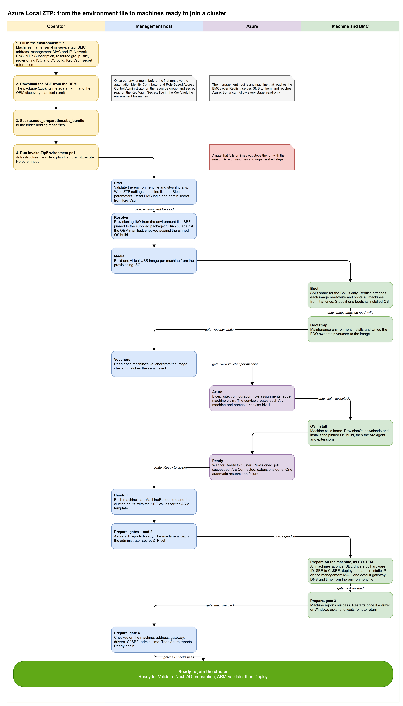

# Design and architecture

> How the zero-touch provisioning (ZTP) solution takes bare machines to "ready for Validate": the stages and their gates, what runs where, how data moves, how a run resumes, and what the solution doesn't do.

The solution automates Microsoft's [simplified machine provisioning (preview)](https://learn.microsoft.com/azure/azure-local/deploy/simplified-machine-provisioning) without a USB stick or anyone in the rack. The baseboard management controller (BMC) presents a virtual USB image to each machine. The maintenance environment writes its ownership voucher back into that image. The solution then claims the machines in Azure, waits for the OS install, and readies each node for cluster validation.

For the operator steps, see the [Operator guide](operator-guide.md). To run it from CI/CD, see [Running from a pipeline](automation-pipelines.md).

## The flow

The diagram source is [`diagrams/ztp-flow.drawio`](./diagrams/ztp-flow.drawio). It has four lanes: the operator, the management host, Azure, and the machine with its BMC. The operator supplies two inputs, the environment file and the OEM's Solution Builder Extension (SBE). Then the operator runs one command: `Invoke-ZtpEnvironment.ps1 -InfrastructureFile <file>`, first as a plan, then with `-Execute`.

## Entry point and layers

| Layer | Script | Role |
| --- | --- | --- |
| Entry point | `Invoke-ZtpEnvironment.ps1` | Reads and checks the environment file. Writes the generated inputs (node list, orchestrator settings, Bicep parameters). Reads the BMC login from Key Vault. Creates the resource group if it's missing. Runs the orchestrator, then Prepare. |
| Orchestrator | `Invoke-ZtpProvisioning.ps1` | Runs the eight provisioning stages in order. Checks each stage's result. Records completed stages in a state file. |
| Node preparation | `Initialize-ZtpNode.ps1` | The Prepare stage. Runs after Ready to cluster. |
| Stage scripts | `Get-ZtpBootstrapIso.ps1`, `Get-ZtpSbe.ps1`, `New-ZtpVirtualUsbImage.ps1`, `Start-MaintenanceBoot.ps1`, `Mount-ZtpVirtualUsb.ps1`, `Publish-MaintenanceIso.ps1`, `Wait-ZtpBootstrapComplete.ps1`, `Wait-ZtpVoucher.ps1`, `Invoke-ZtpAzureProvisioning.ps1`, `Wait-ZtpMachineReady.ps1`, `New-ZtpHandoff.ps1`, `Convert-ZtpHandoffToClusterInputs.ps1` | Each stage's work. Each script can run alone and is a plan unless you pass `-Execute`. |
| Template | `bicep/main.bicep` | Site, site configuration, role assignments and one edge machine per node, claimed with the vouchers. |

All scripts are in `scripts/simplified-provisioning/`. The orchestrator reference is [Orchestrator reference](automated-bootstrap.md).

## Stages and gates

A stage starts only when the gate before it passes. A gate that fails, or times out, stops the run and names the reason.

| # | Stage | What it does | Gate before the next stage |
| --- | --- | --- | --- |
| 0 | Start | Checks the environment file and stops if it's invalid. Writes the generated inputs. Reads the BMC login from Key Vault. | The environment file is valid. |
| 1 | Resolve | Finds, downloads and hash-checks the maintenance ISO for the train named in `ztp.provisioning_iso`. Checks the SBE package you supplied against the SHA-256 in the OEM's discovery manifest. | A verified ISO exists. The SBE hash matches the OEM manifest. |
| 2 | Media | Builds one raw virtual-USB image per node from the ISO: GPT, one FAT32 partition labelled `CDROM`. | One image per node. |
| 3 | Boot | Shares the images over SMB, read-write, to the BMC addresses only. Closes stale SMB handles. Inserts each node's image in the BMC's USB-stick slot, sets a one-time boot and resets the node. All nodes in parallel. | On iDRAC 7.30 the boot override must read `Once/Floppy` before the reset (the USB-stick slot boots as virtual floppy there; see [iDRAC quirks](troubleshooting.md#idrac-quirks)). For 10 minutes after the reset, the iDRAC log must not show `OSE1002`, logged on the live runs as "C: boot completed" when the installed OS booted. |
| 4 | Bootstrap | Watches the BMC and the image until the maintenance environment writes its voucher back. | Every node reaches `ReadyForPortal`: a valid voucher, and the Azure prerequisites checked. |
| 5 | Vouchers | Reads each voucher from its image, checks the serial, replaces a spent local copy, ejects the media, removes the share. | One valid voucher per serial. |
| 6 | Azure | Checks prerequisites, builds the Bicep template, runs a what-if, then submits the claim. Refuses to submit when a voucher is missing. | ARM accepted the deployment. |
| 7 | Ready | Waits for "Ready to cluster" on every node. If a `ProvisionOs` job fails, it re-PUTs `jobs/ProvisionOs` once with the edge machine's existing OS profile and user details. | Each node: lifecycle `Provisioned`, `ProvisionOs` succeeded, Arc `Connected`, mandatory extensions `Succeeded`. |
| 8 | Handoff | Writes the handoff file and the cluster inputs with each machine's `arcMachineResourceId`. | Both files written. |
| 9 | Prepare | Installs the OEM's network drivers from the SBE, copies the SBE to `C:\SBE`, creates the deployment admin, sets one static management address. All nodes in parallel. | Each node passes the on-node checks and Azure reports it Ready again. The run prints `<node> is ready for Validate`. |

Stages 1 to 8 are the orchestrator. Stage 9 is `Initialize-ZtpNode.ps1`, which `Invoke-ZtpEnvironment.ps1` runs after the orchestrator.

### The Prepare gates

Prepare exists because a freshly provisioned node isn't ready for cluster validation. It runs on inbox network drivers, has DHCP and a default gateway on more than one port, and has an empty `C:\SBE`. Microsoft Learn says inbox drivers aren't supported ([host network requirements](https://learn.microsoft.com/azure/azure-local/concepts/host-network-requirements#driver-requirements)). Cloud deployment validation fails when more than one physical adapter has a default gateway ([network considerations, decision 8](https://learn.microsoft.com/azure/azure-local/plan/cloud-deployment-network-considerations#decision-8-determine-management-ips-and-infrastructure-network)). Learn also says to install the OEM's drivers and firmware and to place the SBE in `C:\SBE` before deployment, which means before Validate and Deploy ([install drivers and firmware](https://learn.microsoft.com/azure/azure-local/deploy/deployment-install-os#install-drivers-and-firmware)). Prepare installs the drivers; it doesn't install firmware.

| Gate | Check |
| --- | --- |
| Gate 1 | Azure reports the node Ready to cluster. |
| Gate 2 | The node accepts a WinRM sign-in with the provisioning administrator secret. |
| Work | Copies the three SBE files to `C:\SBE` (hash checked). Picks the network drivers from the SBE by each adapter's PCI hardware ID and checks their catalog signatures. Creates the deployment admin. A scheduled task running as SYSTEM installs the drivers with `pnputil` and sets a static IP on the adapter with the management MAC. On every other adapter with a routable address, and on adapters of the same model as the management adapter, it turns off DHCP and removes the gateway. It also sets DNS and time. The task keeps running if the session drops. |
| Gate 3 | The node reports success. If a driver or Windows asks for a restart, the node restarts once and the run waits for a new boot time. |
| Gate 4 | Checked on the node: static address, one default gateway, every adapter on its SBE driver, `C:\SBE` complete, deployment admin present, time source. Then Azure must report Ready again. |

## What runs where

| Where | What runs there |
| --- | --- |
| Management host | Every script, in PowerShell 7, elevated. It must be Windows because the Boot stage shares the images with Windows SMB, a local account and a Windows Firewall rule. It's the Redfish client to the BMCs, the ARM client to Azure, and the WinRM client to the nodes during Prepare. All media, vouchers, state and handoff files live on this host. |
| BMC | Mounts the node's image from the host's SMB share as a USB stick. Applies the one-time boot and resets the node. Writes the event log the Boot gate reads. |
| Machine | Boots the maintenance environment from the virtual USB. It installs itself to the boot disk and writes the voucher back into the image. After the claim, it calls home and Azure installs the OS, the Arc agent and the extensions. During Prepare, a scheduled task runs on it as SYSTEM. |
| Azure | The site, site configuration, edge machines and role assignments from `bicep/main.bicep`. The device onboarding service, the `ProvisionOs` job, and Azure Arc. Key Vault holds the BMC login, the provisioning administrator password and the deployment admin password. |

### Network paths

| From | To | Port | Used by |
| --- | --- | --- | --- |
| Management host | Each BMC | TCP 443 (Redfish over HTTPS) | Boot, Bootstrap, Vouchers (eject) |
| Each BMC | Management host | TCP 445 (SMB) | Boot: the BMC's SMB client connects out from its management IP to the host's share, then reads and writes the image. No inbound SMB port is needed on the BMC. |
| Management host | Each node's management IP | TCP 5985 (WinRM over HTTP) | Prepare |
| Management host | Azure, Microsoft download, OEM manifest | TCP 443 | Every stage that reads or changes Azure; Resolve |
| Each node | Azure | TCP 443 (and 80) | Onboarding, OS download, Arc ([firewall requirements](https://learn.microsoft.com/azure/azure-local/concepts/firewall-requirements)) |

The host needs inbound TCP 445 from the BMC addresses only. `Publish-MaintenanceIso.ps1` creates that Windows Firewall rule, scoped to the BMC addresses in the environment file. It also creates a dedicated local account with Change access on the share (Read when it shares an ISO). The Vouchers stage removes the share, the rule and the account.

## Data flow

| Data | Path | Where it's kept |
| --- | --- | --- |
| Maintenance ISO | Microsoft download link `https://aka.ms/aep/installeros/<YYMM>`, then the host cache, then one image per node, then the SMB share, then the BMC, then the machine. | `_media/bootstrap/<version>/` with a trust-on-first-use manifest. Microsoft publishes no hash for this download; see [Bootstrap media and the OEM SBE](bootstrap-media-and-sbe.md). |
| Per-node image | Built on the host, shared to the BMC, written back by the machine. | `_media/ztp-virtual-usb/ztp-usb-<node>.img` |
| Ownership voucher | The machine writes `\vouchers\<serial>\*.pem` into its own image. The host reads it after the eject and writes `<serial>.pem`. At claim time it's base64-encoded into a secure deployment parameter. It's never printed. | `_media/vouchers/<serial>.pem`. Vouchers are one-time use. |
| BMC login | Key Vault, read into memory. | Never written. |
| SMB share account | Generated with a random password for each publish, held in memory only, removed after the Vouchers stage. | Never written. |
| Provisioning administrator password | Must already exist as a Key Vault secret. The template passes only the secret's resource ID. Each edge machine's identity gets a constrained right to grant Key Vault Secrets User on the vault, so the OS install can read it. Prepare reads it to sign in. | Key Vault |
| Deployment admin password | Key Vault (`credentials.local_admin_password_secret`). Prepare reads it and creates the local account. | Key Vault |
| The claim | One ARM deployment of `bicep/main.bicep` with the vouchers in memory. | Resource group deployment history |
| SBE | You download it from the OEM. Resolve and Prepare check its SHA-256 against the OEM's discovery manifest. Prepare extracts the network drivers once and copies the three SBE files to each node. | Your folder (`ztp.node_preparation.sbe_bundle`); drivers in `_media/sbe-drivers/<sbe>/`; `C:\SBE` on each node. |
| Handoff | Written after Ready. Holds each node's `arcMachineResourceId`, read from the edge machine after Ready, so it names the service-created `<device-id>-1` Arc machine. Also the site, the solution version and the SBE values. | `_media/ztp-state/<run>.ztp-handoff.json`, `<run>.ztp-cluster-inputs.yaml`, `<run>.arc-machine-names.json` |
| Events | One JSON line per state change and per stage. | `_media/ztp-state/ztp-events.jsonl` |

`_media` is a folder next to the repository clone, not inside it: `<parent of the clone>/_media`. `<run>` is the node names of the run joined with `+`, for example `node-01+node-02`.

The entry point also writes three generated files inside the clone. They hold environment values, so keep them out of source control:

- `config/simplified-provisioning/nodes.json`
- `config/simplified-provisioning/ztp-provisioning.json`
- `scripts/simplified-provisioning/bicep/main.parameters.json`

## Idempotence and resume

- **State per set of nodes.** The orchestrator records each completed stage, with its evidence, in `_media/ztp-state/<run>.ztp-provisioning.state.json`. Each set of nodes keeps its own state, so a run for `node-02` alone never disturbs a run for both nodes.
- **A rerun resumes.** Run the same command again with the same `-Node` list. The orchestrator starts at the first stage that didn't complete. Prepare always runs after it, and it skips steps that are already done.
- **`-From <Stage>`** runs that stage and every later one, whatever the state file says. `-From Prepare` runs only Prepare. The stages you can name are `Resolve`, `Media`, `Boot`, `Bootstrap`, `Vouchers`, `Azure`, `Ready`, `Handoff` and `Prepare`.
- **The Azure stage never re-PUTs an existing edge machine.** It claims only the nodes whose edge machine doesn't exist yet. If ARM already has every edge machine, Azure goes straight to Ready.
- **Images.** A run from the start, or `-From Resolve` or `-From Media`, rebuilds the images. That's a fresh provisioning.
- **Prepare** reads the node's state first. It copies the SBE only if `C:\SBE` doesn't hold it, installs a driver only where the adapter isn't already on that version, and leaves a static address that's already correct.

Running from `Boot` or earlier reinstalls the machines. For a node that's already claimed, delete its edge machine in Azure first. See [Resume a stopped run](operator-guide.md#resume-a-stopped-run).

## Parallelism

| Stage | How nodes run |
| --- | --- |
| Media | The first image is built. The others are byte copies. |
| Boot | One worker per node (`ForEach-Object -Parallel`). Each one mounts, resets and watches its own BMC. A failure on one node doesn't stop the others. The stage fails afterwards with every node's error. |
| Bootstrap, Vouchers, Ready | One polling loop over all nodes. |
| Azure | One deployment claims every node that has no edge machine yet. |
| Prepare | One `pwsh` worker process per node, after the SBE is checked and unpacked once. Each output line carries its node name. |

## What the solution doesn't do

The run stops at "ready for Validate". These steps are separate:

| Not done | Notes |
| --- | --- |
| Active Directory preparation | Learn lists it as an on-site prerequisite of simplified machine provisioning ([prerequisites](https://learn.microsoft.com/azure/azure-local/deploy/simplified-machine-provisioning#on-site-prerequisites)). |
| Cluster Validate and Deploy | Use the handoff's `arcMachineResourceId` values with the portal or the ARM template. See [What to hand to the cluster deployment](operator-guide.md#what-to-hand-to-the-cluster-deployment). |
| Firmware updates | Prepare installs network drivers from the SBE only. |
| Arc gateway or a proxy | Simplified machine provisioning doesn't support Arc gateway in the preview ([Learn](https://learn.microsoft.com/azure/azure-local/deploy/simplified-machine-provisioning#about-simplified-machine-provisioning-process)). The environment-file path sets the site connectivity to `Public`. |
| Management VLAN | The environment-file path sets no VLAN. Learn says a management VLAN must be on the physical adapter before Arc registration ([management VLAN ID](https://learn.microsoft.com/azure/azure-local/plan/cloud-deployment-network-considerations#management-vlan-id)). |

## Limits

- Simplified machine provisioning is in **preview**. Only the **East US** region supports the provisioning resources ([Learn](https://learn.microsoft.com/azure/azure-local/deploy/simplified-machine-provisioning#azure-prerequisites)).
- Learn's validated hardware for this flow is Lenovo ThinkAgile MX650 V3 and V4, HPE ProLiant DL360 Gen11, and Dell AX-750 and AX-650 ([hardware prerequisites](https://learn.microsoft.com/azure/azure-local/deploy/simplified-machine-provisioning#hardware-prerequisites)). The end-to-end flow here was **proven on Dell AX-760 / iDRAC 7.30**, which isn't on that list. It works, but Microsoft doesn't support it for this flow.
- The BMC handling is proven on Dell iDRAC only. Prepare needs `sbe.driverPaths` in `config/oem/<vendor>.json`, and only `dell.json` has it today.
