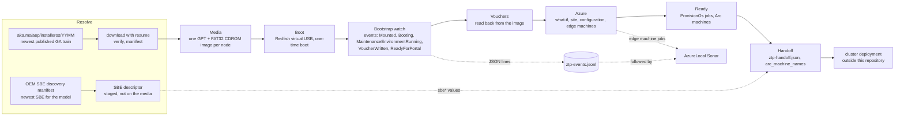
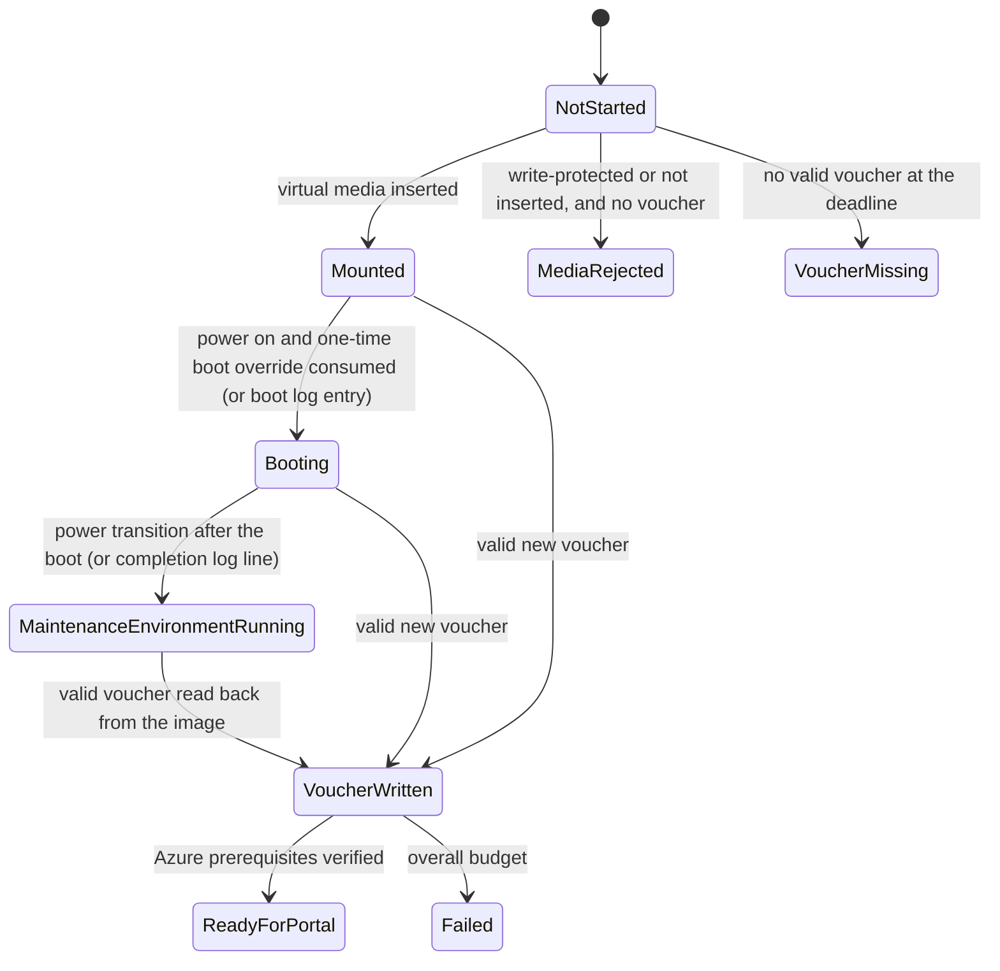

# Automated bootstrap

> One command takes bare Dell nodes from nothing to Arc-connected machines that are ready to cluster: it finds the newest maintenance ISO and the OEM's newest SBE, builds one virtual USB per node, boots the nodes over Redfish, watches the bootstrap finish, collects the vouchers, creates the site and the edge machines in Azure, waits for ready and writes the handoff to cluster deployment.

Companion pages: [Bootstrap media and the OEM SBE](bootstrap-media-and-sbe.md) (what is downloaded, how "newest" and integrity work), [Redfish virtual USB and voucher read-back](redfish-virtual-usb-vouchers.md) (the boot and voucher mechanics) and [Azure provisioning from vouchers](azure-provisioning-vouchers.md) (the template).

## The story in one picture





## One command

Plan (changes nothing; resolves read-only, prints every stage and the plan of the next one):

```powershell
Copy-Item ./config/simplified-provisioning/ztp-provisioning.example.json ./config/simplified-provisioning/ztp-provisioning.json   # edit your values
Copy-Item ./config/simplified-provisioning/nodes.example.json ./config/simplified-provisioning/nodes.json
Copy-Item ./scripts/simplified-provisioning/bicep/main.example.parameters.json ./scripts/simplified-provisioning/bicep/main.parameters.json

./scripts/simplified-provisioning/Invoke-ZtpProvisioning.ps1 -ConfigPath ./config/simplified-provisioning/ztp-provisioning.json
```

Act (a resumable run; a rerun continues at the first stage that did not complete):

```powershell
$bmc   = Get-Credential        # iDRAC account
$admin = Read-Host -AsSecureString 'Provisioning administrator password'
Connect-AzAccount

./scripts/simplified-provisioning/Invoke-ZtpProvisioning.ps1 `
    -ConfigPath ./config/simplified-provisioning/ztp-provisioning.json `
    -BmcCredential $bmc -AdminPassword $admin -ConfirmNotClustered -SkipCertificateCheck -Execute
```

Watch it in another window: `./scripts/simplified-provisioning/Start-ZtpMonitor.ps1 -SonarPath <azurelocal-sonar folder> -SubscriptionId ... -ResourceGroupName ... -NodesFile ... -Execute`, or simply `Get-Content ./ztp-events.jsonl -Wait`.

The settings file is validated by `config/simplified-provisioning/ztp-provisioning.schema.json` (and the node list by `nodes.schema.json`); keys are parameter names of the orchestrator and a command-line parameter wins over the file.

### Stages

| Stage | Script | What it does | Result checked before the next stage |
|-------|--------|--------------|--------------------------------------|
| Resolve | `Get-ZtpBootstrapIso.ps1`, `Get-ZtpSbe.ps1` | Newest GA maintenance ISO into `BootstrapCacheDirectory`; the OEM's newest SBE for `SbeModel` (descriptor only). Skipped when no cache directory is set (then `SourcePath` is the ISO). | A verified ISO exists |
| Media | `New-ZtpVirtualUsbImage.ps1` | One GPT + FAT32 (`CDROM`) image per node from that ISO | One image per node |
| Boot | `Start-MaintenanceBoot.ps1` | Share, read-write virtual USB on the BMC USB-stick slot, one-time USB boot, restart | Every node attached read-write and restarted |
| Bootstrap | `Wait-ZtpBootstrapComplete.ps1` | One read-only watch with the states and events below | Every node `ReadyForPortal` |
| Vouchers | `Wait-ZtpVoucher.ps1` | Eject, write `<serial>.pem`, remove the share | A valid voucher per node |
| Azure | `Invoke-ZtpAzureProvisioning.ps1` | Prereqs, Validate, Plan (what-if), Execute: site, configuration, edge machines from `bicep/main.bicep` | No voucher problem; deployment accepted |
| Ready | `Invoke-ZtpAzureProvisioning.ps1 -Stage Watch`, `Test-ProvisionedMachines.ps1` | `ProvisionOs` jobs until ready to cluster; Arc machines and extensions | Every machine ready and verified |
| Handoff | `New-ZtpHandoff.ps1`, `Convert-ZtpHandoffToClusterInputs.ps1` | `ztp-handoff.json` and the `arc_machine_names` block | Both files written |

Run one stage again with `-Stage`, from a stage onward with `-From`, forget progress with `-ResetState`. Each stage also writes `StageStarted`, `StageCompleted` or `StageFailed` events (node `*`) to the event file.

`Invoke-ZtpPrepareMedia.ps1 -ConfigPath ... [-Execute]` runs only the first two stages plus a read-back verification of the images (the "prepare everything" step).

## The bootstrap watch

`Wait-ZtpBootstrapComplete.ps1` polls one loop for all nodes, starting at 15 seconds and backing off by 1.5x to 120 seconds while nothing changes (any state change resets it). Signals, none of which needs a credential on the node:

| Signal | Source | Strength |
|--------|--------|----------|
| Virtual media inserted, slot write-protection | Redfish `VirtualMedia` (GET) | Strong for `Mounted`; write-protected attach is rejected while no voucher exists |
| Power state, one-time boot override consumed, power transitions after it | Redfish `Systems` (GET) | **Weak, unverified on iDRAC for this media** |
| BMC log entries matching the OEM patterns (`config/oem/dell.json`) | Redfish `LogServices` (`Lclog`, `Sel`) | **Weak, unverified**; patterns are conventions, not proven messages |
| `\vouchers\<serial>\*.pem` valid in the read-write image | Image read-back on this host | **Decisive**, but the write-back is **not yet proven live** |
| Voucher in a Configurator App folder | `-VoucherFolder` | Fallback; replaces the BMC and image signals |
| Feature `Microsoft.DeviceOnboarding/AzureLocalZTP`, resource providers, OS image catalog | ARM GET | Proves Azure is ready to claim, not that it saw the device |

Learn documents no Azure-side signal that a device is waiting to be claimed: a device is unknown to Azure until its voucher is submitted. `ReadyForPortal` therefore means **a valid, new voucher is in hand and the Azure prerequisites are verified**, and the next stage submits it. Weak states never fail a node (a stall only emits a warning); a node fails only at the voucher deadline (`VoucherMissing`, default 90 minutes; Learn says setup takes up to 30 minutes with two reboots) or the overall budget (`Failed`). A voucher already in the image before the node is seen booting is flagged and is not accepted until the node is seen booting or the voucher changes (an image reused from an earlier run).

### Events

One JSON object per line:

```json
{"timestamp":"2026-10-15T14:00:00.0000000Z","node":"node-01","state":"VoucherWritten","evidence":"valid ownership voucher read back from the image; voucher SHA256 <hash>","nextAction":"Checking that Azure is ready to claim the voucher.","level":"Info","stage":"Bootstrap"}
```

Levels are `Info`, `Warning` and `Error`. Vouchers are never logged, only their SHA256.

## Monitoring with Sonar

`Start-ZtpMonitor.ps1` writes a Sonar config (`provisioningRoute: simplified`, the nodes, `ztpEvents.path` = the event file) and starts `Start-AzlSonar.ps1`. Sonar shows the ZTP events in its log pane (the `ztpEvents` option is on the Sonar branch `feature/ztp-provisioning`; an older Sonar ignores the key) and, once the edge machines exist, their `ProvisionOs` jobs and lifecycle stages from Azure, read-only. Record and replay work as usual (`-Record`).

## Handoff to cluster deployment

`New-ZtpHandoff.ps1` requires every machine to be ready to cluster and writes `ztp-handoff.json` (schema version 1): node names and serials, the **Arc machine names** (simplified machine provisioning names them by device ID, for example `<device-id>-1`, not by host name), their resource IDs and resource group, the site, the solution recipe version (`vsrVersion`), the maintenance ISO version and hash, the SBE, and the bootstrap timestamps. `Convert-ZtpHandoffToClusterInputs.ps1` turns it into what the cluster deployment solution reads from its environment file:

```yaml
arc_machine_names:
  node-01: '<device-id-of-node-01>-1'
  node-02: '<device-id-of-node-02>-1'
sbe:
  version: '5.0.2606.1616'
  family: 16G-45n0c-Intel
  publisher: Dell
  manifest_source: 'https://aka.ms/AzureStackSBEUpdate/DellEMC'
  manifest_creation_date: '2026-06-24T05:58:20Z'
release:
  azure_local_version: '12.2609.1003.7'
  sbe_version: '5.0.2606.1616'
```

Paste `arc_machine_names` (required; the map is host name to Arc machine name, a node missing from it falls back to its host name) into the environment file. `sbe` is the descriptor the deployment passes as `sbePartnerInfo`. Check `release.*` against your environment schema before pasting; only `arc_machine_names` is needed. The handoff holds Azure resource IDs: keep it out of source control (`.gitignore` covers the default names).

## What stays manual, and why

| Step | Why |
|------|-----|
| Supplying the iDRAC account and the provisioning administrator password | Secrets are parameters, never files; `-BmcCredential` is a `PSCredential`, `-AdminPassword` a `SecureString` |
| `-ConfirmNotClustered` | The maintenance boot reinstalls the machine; nothing here may touch a cluster |
| Obtaining the SBE package from the OEM (or letting the download connector fetch it) | The OEM manifest publishes no URI; credentials are the OEM's |
| Registering `Microsoft.DeviceOnboarding/AzureLocalZTP` and the resource providers, the Key Vault and the first Azure Local resource provider app object ID | Subscription-level preconditions; the bootstrap watch checks them and names what is missing |
| Cluster deployment | A separate solution; this repository ends at the handoff |

## What is proven and what is not

| Area | State |
|------|-------|
| Resolving, downloading, verifying the newest maintenance ISO; building and read-back-checking the per-node images from it | **Verified live** on 15 Oct 2026 (no hardware) |
| SBE discovery for Dell | **Verified live**; package download is not possible from the manifest |
| Booting the image from the iDRAC USB-stick slot | Proven for an earlier maintenance build on a Dell 16G server; `10.2610` not yet |
| Voucher write-back into the read-write image; the BMC override, power and log signals; the ISO on the CD slot | Write-back and the weak signals **not proven**; the CD slot **failed** earlier (use the USB slot) |
| Bootstrap watch, event file, backoff, state machine, Sonar adapter, handoff and conversion | Unit tested against mocks and recorded fixtures (see the test suites); **not run against hardware or Azure** |
| Azure readiness check (feature registration `2021-07-01`, providers `2021-04-01`) | Mocked only; the calls are standard ARM reads, **not yet run live** |
| `main.bicep` at `edgeMachines@2026-10-01` and `sites@2025-06-01` | Builds and lints clean; **no what-if or deployment run**. The properties used are unchanged from the live-proven `2025-12-01-preview`; if the what-if or the first claim disagrees, set the version back in one place |

## Live proofs still needed, in this order

1. **Voucher write-back.** One node, one read-write image on the USB-stick slot, boot, then `Wait-ZtpBootstrapComplete.ps1`: does `\vouchers\<serial>\<serial>.pem` appear in the image? If not, the pipeline needs the Configurator App fallback (`-VoucherFolder`) and the design must say so.
2. **The `10.2610` image boots** from the iDRAC USB-stick slot and the setup reaches "Maintenance environment setup completed successfully" in about 30 minutes with two reboots. Compare what the BMC reports (boot override, power transitions, `Lclog` and `Sel` entries) with the patterns in `config/oem/dell.json` and correct them.
3. **Azure.** Run Prereqs, Validate and Plan (the what-if), then claim **one** node with the stable API versions and watch `ProvisionOs` to ready; confirm the Arc machine name matches `arc_machine_names`.
4. **Sonar** against that run (`Start-ZtpMonitor.ps1`), then the handoff into a cluster deployment Validate pass.

## Known gaps

- Role-assignment names in `main.bicep` use the portal's per-run salt (`newGuid()`); a re-run after a partial failure reconciles role assignments only for machines it creates (machines that already exist are left out). Check the role assignments of a machine created by a failed run by hand.
- The signals marked weak depend on iDRAC behaviour that was not observed; they only change the reported state, never fail a node.
- Hashing and extracting the downloaded zip are separate steps; protect the cache folder from other writers.
