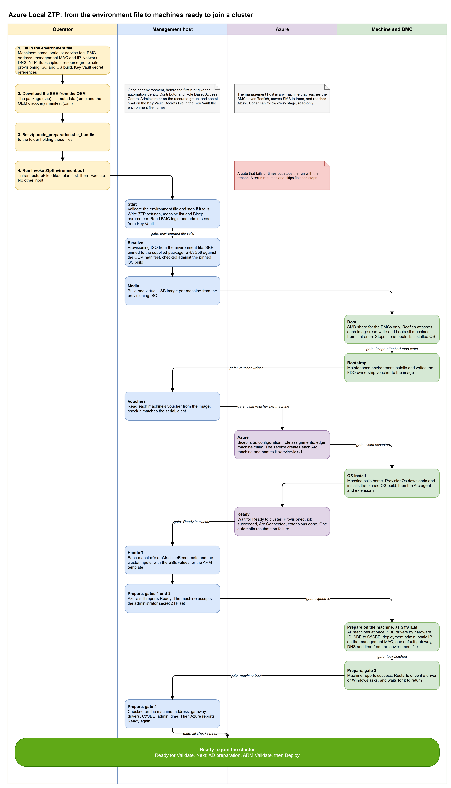

## How a run flows

| You supply | You get |
| --- | --- |
| The environment file: machines, BMC addresses, network, Azure subscription, resource group, site, OS build, and Key Vault references | Every machine provisioned on the pinned Azure Local build, Arc connected, and ready for cluster Validate |
| The folder with the OEM's SBE files | The OEM network drivers installed, the SBE in `C:\SBE`, and a handoff with each machine's `arcMachineResourceId` |

::: warning Preview
Microsoft's simplified machine provisioning is in preview, in East US only, and doesn't support Arc gateway. Read the [overview](/overview) for the current status and limits before you start.
:::

## Part of the Azure Local tools

Check the network with [Beacon](https://azurelocal.cloud/azurelocal-beacon/) before you start, watch the run with [Sonar](https://azurelocal.cloud/azurelocal-sonar/), and document the result with [Ranger](https://azurelocal.cloud/azurelocal-ranger/). More at [azurelocal.cloud](https://azurelocal.cloud/).
