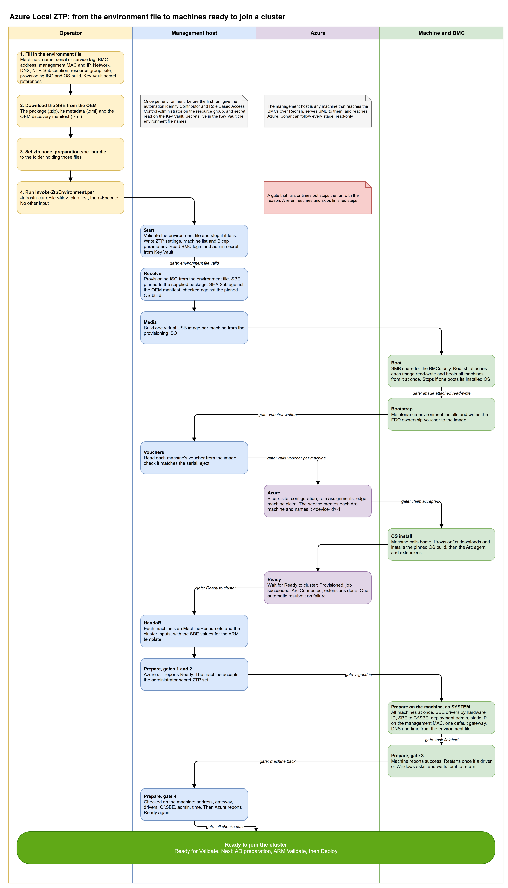

# Overview

> Zero-touch provisioning for Azure Local: from bare machines to provisioned, Arc-connected nodes, with one command and no USB stick.

## What this repo does

Microsoft's [simplified machine provisioning (preview)](https://learn.microsoft.com/azure/azure-local/deploy/simplified-machine-provisioning) has an operator write a USB stick, plug it into each machine, collect each voucher, and claim the machines in the portal. This repo automates the whole flow from a management host or a pipeline:

1. Downloads and checks the maintenance ISO, and builds one virtual USB image per node.
2. Sets the BIOS values the file names, and boots each node from its image over the BMC (Redfish virtual media). No one needs to be in the rack.
3. Reads each node's ownership voucher back from its image.
4. Sets each static management address on the port with the node's management MAC, in the maintenance environment, before the claim. A node without a known maintenance address is found by scanning the DHCP range for its MAC.
5. Claims the machines in Azure with a Bicep template, waits for the OS install and Arc, and resubmits a failed OS install once.
6. Checks each management address on the management port through Azure after the install, and moves it there if needed.
7. Sets back any BIOS value that was changed for the install only, and waits until each machine is Connected again.
8. Writes a handoff with each machine's Arc machine name and `arcMachineResourceId`.

The stages are Resolve, Media, Boot, Bootstrap, Vouchers, Device, Azure, Ready, Network, Restore and Handoff.

You supply one thing: an environment file, started from one of the toolkit's templates (see [Pick the template](operator-guide.md#pick-the-template)). Then you run `Invoke-ZtpEnvironment.ps1`, first as a plan, then with `-Execute`.

**The result:** each machine is **Provisioned** in Azure and **Arc-connected**, with its management IP on the management NIC (found by MAC) as the infrastructure file says. The Arc machine IDs are in the handoff. The nodes are ready for OS configuration, not yet for Validate: OEM drivers, the SBE, DHCP off on the other NICs, DNS and time on the host, and the deployment admin come next, in [azurelocal-toolkit Phase 03: OS Configuration](https://azurelocal.cloud/docs/implementation/04-cluster-deployment/phase-03-os-configuration/). See [What's next: OS configuration](operator-guide.md#whats-next-os-configuration).

## Status

| Item | State |
| --- | --- |
| Microsoft feature | Preview. Provisioning resources in East US only. Arc gateway not supported ([Learn](https://learn.microsoft.com/azure/azure-local/deploy/simplified-machine-provisioning)). |
| End-to-end flow | **Proven on Dell AX-760 / iDRAC 7.30**, two nodes, Azure Local build `12.2690.1003.15`, maintenance image `10.2610.0.3063`. AX-760 isn't on Learn's validated list for this flow, so it's not supported by Microsoft. |
| Other OEMs | The BMC handling is proven on Dell iDRAC only. Lenovo, HPE and Supermicro have OEM files with empty BMC signal patterns, marked unverified. |
| Scope | Ends at the handoff: provisioned, Arc-connected nodes with the management address on the management NIC. OS configuration, Active Directory preparation, Validate and Deploy are separate. |

## Where to start

| If you want to... | Read |
| --- | --- |
| Check what to have in place first | [Prerequisites](prerequisites.md) |
| Understand the stages, gates, data flow and limits | [Design and architecture](architecture.md) |
| Run it from a management host | [Operator guide](operator-guide.md) |
| Know what comes after ZTP | [What's next: OS configuration](operator-guide.md#whats-next-os-configuration) |
| Fill in the environment file | [Master infrastructure.yml (schema 5)](infrastructure-schema-5.md), or the [Environment file reference](environment-file.md) for the older layout |
| Run it from Azure DevOps, GitHub Actions or GitLab CI | [Running from a pipeline](automation-pipelines.md) |
| Fix a failed or slow run | [Troubleshooting and known issues](troubleshooting.md) |
| Drive the orchestrator directly, or read the event format | [Orchestrator reference](automated-bootstrap.md) |
| Know how the maintenance ISO is found and checked | [Bootstrap media](bootstrap-media.md) |
| Know how the virtual USB boot and voucher read-back work | [Redfish virtual USB and voucher read-back](redfish-virtual-usb-vouchers.md) |
| Know what the Azure template creates | [Azure provisioning from vouchers](azure-provisioning-vouchers.md) |

The [Server preparation](server-preparation.md) and [Azure portal provisioning](azure-portal-provisioning.md) guides describe an earlier, manual route. They're kept for reference and are superseded by the operator guide.
